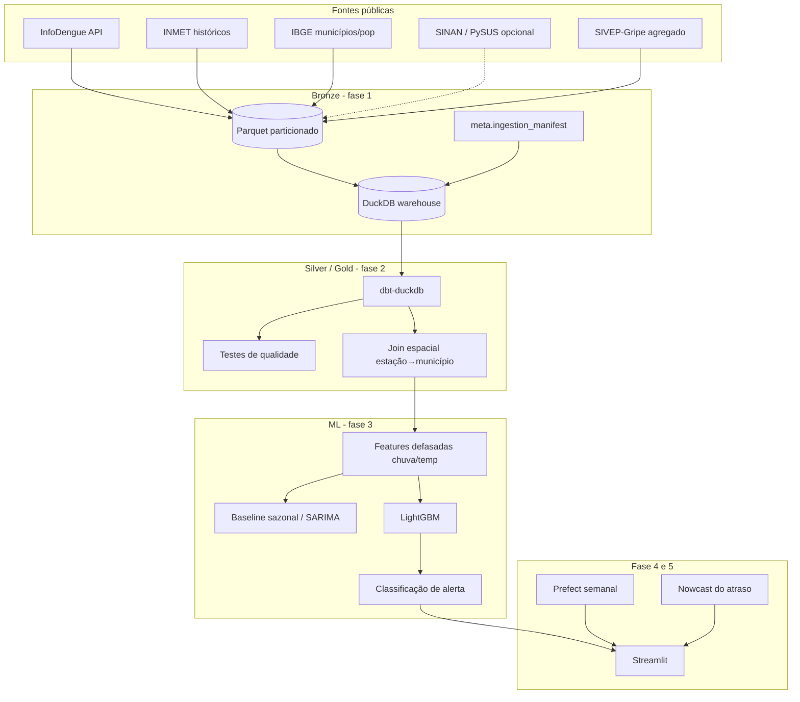

# dengue-forecast-br

**Engenharia de dados + machine learning para antecipar surtos de dengue por município no Brasil** — começando por **Cuiabá e Mato Grosso**.

> Projeto de portfólio de [Eric Guerrize](https://github.com/EricGuerrize), analista de dados no TCE-MT (Cuiabá), posicionado como perfil **data engineer + ML**. Desenvolvimento local com **Antigravity IDE**.

---

## Em linguagem simples

A dengue sobe e desce com o clima (chuva, calor, umidade) e com o atraso das notificações. Este projeto monta uma **plataforma de vigilância epidemiológica** que:

1. **Reúne** dados públicos de casos (InfoDengue / SINAN), clima (INMET) e território/população (IBGE).
2. **Organiza** tudo num lakehouse (`bronze → silver → gold`) com DuckDB + dbt.
3. **Prevê**, por município, casos/incidência semanal **4–8 semanas à frente** e classifica alerta (verde / amarelo / vermelho).
4. **Mostra** o risco num mapa e atualiza a série toda segunda-feira.

Na prática: *se choveu forte nas últimas semanas, o modelo ajuda a estimar se os casos tendem a subir antes do pico chegar ao pronto-socorro.*

---

## Fase atual: 5 — ciclo semanal, SRAG e nowcast

A previsão e a tela estão em [docs/fase-3-previsao.md](docs/fase-3-previsao.md). O ciclo semanal, o SIVEP agregado e o nowcast estão em [docs/fase-4-5-fecho.md](docs/fase-4-5-fecho.md).

```bash
make setup       # Python 3.11+. No macOS, o LightGBM pede `brew install libomp`
make demo        # sample offline → bronze
make transform   # dbt: silver e gold
make forecast    # backtest + previsão 4 e 8 semanas
make nowcast     # corrige as semanas recentes pelo atraso de notificação
make refresh     # o ciclo inteiro, offline, em cima do sample
make viz         # tela em http://localhost:8501
make export-web  # atualiza o JSON da versão pública (Vercel)
```

Ao vivo, para os 141 municípios de MT (a primeira vez pede o histórico desde 2019 com `--backfill`):

```bash
dfc refresh --backfill
dfc refresh --serve    # Prefect: toda segunda às 08:00 em Cuiabá. Extra: pip install -e '.[orchestrate]'
```

---

## Página pública na Vercel

A página em `public/` é estática. A Vercel deve usar a raiz do repositório como Root Directory e a configuração de `vercel.json`, que publica apenas `public/`. O site não roda o Streamlit nem treina modelos durante uma visita.

Depois de atualizar a previsão local, gere e publique um novo recorte:

```bash
dfc forecast
dfc nowcast
make export-web
git add public/data/dashboard.json
git commit -m "data: atualiza previsão pública"
git push
```

O arquivo público contém séries agregadas e previsões municipais. A página mostra a data da última semana e avisa quando ela passa de 14 dias. A atualização depende de uma nova exportação e de um deploy da Vercel; o agendamento local de `dfc refresh` não altera o site sozinho.

---

## Arquitetura (visão alvo)



---

## Roadmap

| Fase | Escopo |
|------|--------|
| **1** | Ingestão + infra: CLI, bronze, DuckDB, sample, demo, CI, Docker |
| **2** | dbt silver/gold, testes de qualidade, join espacial estação→município, população Censo 2022 |
| **3** | Features, baseline sazonal, SARIMA, LightGBM, backtest e tela Streamlit |
| **4** | Ciclo semanal (`dfc refresh`) e flow Prefect, segunda às 08:00 em Cuiabá |
| **5** | SIVEP-Gripe agregado (covid, influenza, VSR) e nowcast do atraso de notificação |

---

## Como rodar

Requisitos: Python 3.11+, Make (opcional), Docker (opcional).

```bash
git clone https://github.com/EricGuerrize/dengue-forecast-br.git
cd dengue-forecast-br
git checkout cursor/phase1-ingestion-infra-8da4   # ou a branch do PR

make setup          # pip install -e ".[dev,transform,forecast,viz,orchestrate]"
make demo           # offline: sample → bronze → PNG em data/artifacts/
make transform      # dbt build silver/gold
make forecast       # modelos e parquets em data/forecast/
make nowcast        # nowcast.parquet a partir do prior do sample
make refresh        # ciclo offline: sample, dbt, previsão e nowcast
make viz            # Streamlit em 0.0.0.0:8501
make lint
make test
```

### CLI `dfc`

```bash
dfc version
dfc ingest ibge --uf MT
dfc ingest infodengue --uf MT --start-year 2019 --end-year 2025
dfc ingest inmet --year 2023 --uf MT
dfc ingest sinan --year 2023 --uf MT          # opcional (PySUS / FTP)
dfc demo --sample-dir data/sample --output-dir data/artifacts
dfc ingest sivep --sample-dir data/sample   # ou sem --sample-dir, agregado OpenDataSUS
dfc transform
dfc forecast
dfc nowcast
dfc refresh --backfill          # MT ao vivo, histórico desde 2019
dfc refresh --serve             # agenda Prefect
dfc viz
```

Modo offline (CI / sem rede):

```bash
dfc ingest ibge --sample-dir data/sample
dfc ingest infodengue --uf MT --start-year 2022 --end-year 2024 \
  --sample-dir data/sample --geocode 5103403
dfc ingest inmet --year 2023 --uf MT --sample-dir data/sample --station A901
```

### Docker

A imagem instala dbt, LightGBM e Streamlit. Na primeira subida, se `data/forecast/` ainda não existir, ela monta o sample offline e abre a tela em `0.0.0.0:8501`.

```bash
docker compose up --build
# http://localhost:8501
```

---

## Fontes, licenças e citação

| Fonte | Uso | Atribuição / acesso |
|-------|-----|---------------------|
| **InfoDengue** | Casos semanais, incidência, nível de alerta, clima derivado | [API](https://info.dengue.mat.br/services/api). Citar: Codeco et al., *InfoDengue* — sistema de alerta para arboviroses. |
| **INMET** | Chuva, temperatura, umidade (estações) | [Dados históricos](https://portal.inmet.gov.br/dadoshistoricos) (BDMEP). Uso conforme termos do INMET. |
| **IBGE** | Municípios, população | [APIs IBGE](https://servicodados.ibge.gov.br/) / Censo. Domínio público estatístico. |
| **DATASUS / SINAN** | Notificações dengue (agregadas) | OpenDataSUS / PySUS — **opcional** (FTP instável). Apenas agregados; sem microdados no repo. |
| **SIVEP-Gripe** | SRAG por município e semana (covid, influenza, VSR) e atraso sintoma→notificação | [OpenDataSUS](https://opendatasus.saude.gov.br/dataset/srag-2021-a-2024). A lista nominal é agregada na memória e o arquivo baixado é apagado. |

Detalhes do sample: [`data/sample/ATTRIBUTION.md`](data/sample/ATTRIBUTION.md).

---

## Ética e limitações

- **Privacidade:** só dados **agregados** (município × semana). Nada de registros individuais.
- **Não é diagnóstico clínico** nem substitui boletins oficiais da SES/MS.
- Modelos epidemiológicos erram; alertas devem ser lidos com incerteza e contexto local (vigilância entomológica, mobilidade, subnotificação).
- InfoDengue já aplica nowcasting; séries são revisadas retrospectivamente.
- Portal INMET / FTP DATASUS podem falhar — por isso o sample offline e SINAN opcional.

---

## Layout do repositório

```
src/dengue_forecast/     # pacote tipado
  cli.py                 # Typer → dfc
  ingest/                # infodengue, inmet, ibge, sinan
  schemas/               # Pandera bronze
  transform/             # dbt build
  forecast/              # features, backtest, alerta
  nowcast/               # correção do atraso de notificação
  orchestrate/           # ciclo semanal e flow Prefect
  viz/                   # tela Streamlit
  demo/                  # exploração + chart
dbt/                     # models silver/gold e testes de qualidade
docs/fase-3-previsao.md  # o que a previsão faz, como e por quê
docs/fase-4-5-fecho.md   # ciclo semanal, SIVEP e nowcast
data/sample/             # sample real < 1 MB (CI offline)
data/reference/          # Censo 2022 MT + centróides (join espacial)
data/bronze/             # gerado (gitignored)
data/forecast/           # gerado (gitignored)
data/warehouse.duckdb    # gerado (gitignored)
tests/                   # pytest + fixtures offline
```

---

## Licença

MIT © Eric Guerrize — ver [LICENSE](LICENSE).
