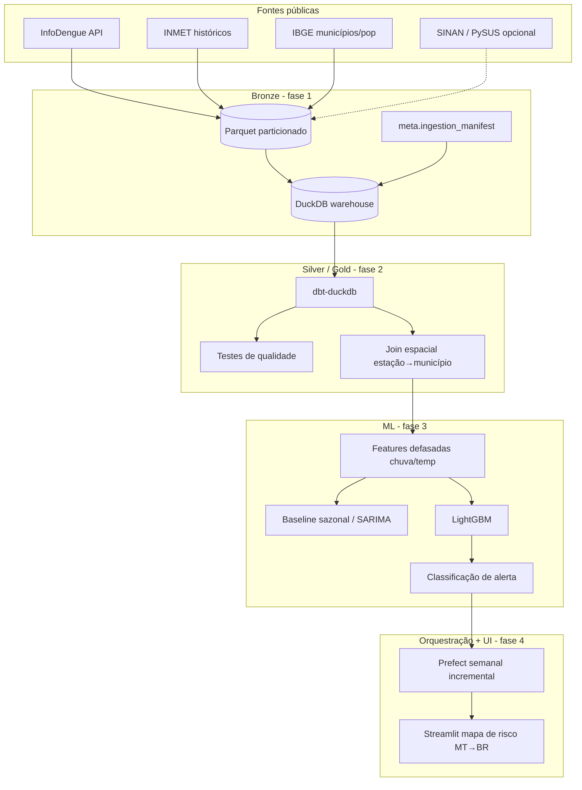

# dengue-forecast-br

**Engenharia de dados + machine learning para antecipar surtos de dengue por município no Brasil** — começando por **Cuiabá e Mato Grosso**.

> Projeto de portfólio de [Eric Guerrize](https://github.com/EricGuerrize), analista de dados no TCE-MT (Cuiabá), posicionado como perfil **data engineer + ML**. Desenvolvimento local com **Antigravity IDE**.

---

## Em linguagem simples

A dengue sobe e desce com o clima (chuva, calor, umidade) e com o atraso das notificações. Este projeto monta uma **plataforma de vigilância epidemiológica** que:

1. **Reúne** dados públicos de casos (InfoDengue / SINAN), clima (INMET) e território/população (IBGE).
2. **Organiza** tudo num lakehouse (`bronze → silver → gold`) com DuckDB + dbt.
3. **Prevê**, por município, casos/incidência semanal **4–8 semanas à frente** e classifica alerta (verde / amarelo / vermelho).
4. **Mostra** o risco num dashboard (mapa) — fase 4 — para apoiar decisão em Cuiabá/MT e, depois, no Brasil.

Na prática: *se choveu forte nas últimas semanas, o modelo ajuda a estimar se os casos tendem a subir antes do pico chegar ao pronto-socorro.*

---

## Fase atual: 1 — ingestão + infraestrutura

Este repositório, nesta fase, entrega:

- Pacote Python `dengue_forecast` (3.11+) com CLI **`dfc`**
- Ingestão **idempotente** para InfoDengue, INMET, IBGE (+ SINAN opcional via PySUS)
- Parquet particionado em `data/bronze/` + registro em `data/warehouse.duckdb`
- Validação Pandera, logging estruturado, rate limit / retries
- Sample real offline em `data/sample/` + `make demo` (gráfico Cuiabá casos × chuva)
- Docker, Compose, GitHub Actions (lint, test, demo, docker build)
- Tooling: ruff, pytest, pre-commit, Makefile

---

## Arquitetura (visão alvo)



---

## Roadmap

| Fase | Escopo |
|------|--------|
| **1 (agora)** | Ingestão + infra: CLI, bronze, DuckDB, sample, demo, CI, Docker |
| **2** | dbt silver/gold, testes de qualidade, join espacial estação→município |
| **3** | Features + baselines (sazonal/SARIMA) + LightGBM + backtesting |
| **4** | Prefect (incremental semanal) + dashboard Streamlit com mapa de risco |
| **5** | SIVEP-Gripe (SRAG: COVID/influenza/RSV) + nowcasting de atraso de notificação |

---

## Como rodar

Requisitos: Python 3.11+, Make (opcional), Docker (opcional).

```bash
git clone https://github.com/EricGuerrize/dengue-forecast-br.git
cd dengue-forecast-br
git checkout cursor/phase1-ingestion-infra-8da4   # ou a branch do PR

make setup          # pip install -e ".[dev]" + pre-commit
make demo           # offline: sample → bronze → PNG em data/artifacts/
make lint
make test
```

### CLI `dfc`

```bash
dfc version
dfc ingest ibge --uf MT
dfc ingest infodengue --uf MT --start-year 2019 --end-year 2025
dfc ingest inmet --year 2023 --uf MT
dfc ingest sinan --year 2023 --uf MT          # opcional (PySUS / FTP)
dfc demo --sample-dir data/sample --output-dir data/artifacts
```

Modo offline (CI / sem rede):

```bash
dfc ingest ibge --sample-dir data/sample
dfc ingest infodengue --uf MT --start-year 2022 --end-year 2024 \
  --sample-dir data/sample --geocode 5103403
dfc ingest inmet --year 2023 --uf MT --sample-dir data/sample --station A901
```

### Docker

```bash
docker compose up --build
# ou
docker build -t dengue-forecast-br:local .
docker run --rm -v "$PWD/data:/app/data" dengue-forecast-br:local
```

---

## Fontes, licenças e citação

| Fonte | Uso | Atribuição / acesso |
|-------|-----|---------------------|
| **InfoDengue** | Casos semanais, incidência, nível de alerta, clima derivado | [API](https://info.dengue.mat.br/services/api). Citar: Codeco et al., *InfoDengue* — sistema de alerta para arboviroses. |
| **INMET** | Chuva, temperatura, umidade (estações) | [Dados históricos](https://portal.inmet.gov.br/dadoshistoricos) (BDMEP). Uso conforme termos do INMET. |
| **IBGE** | Municípios, população | [APIs IBGE](https://servicodados.ibge.gov.br/) / Censo. Domínio público estatístico. |
| **DATASUS / SINAN** | Notificações dengue (agregadas) | OpenDataSUS / PySUS — **opcional** na fase 1 (FTP instável). Apenas agregados; sem microdados no repo. |

Detalhes do sample: [`data/sample/ATTRIBUTION.md`](data/sample/ATTRIBUTION.md).

---

## Ética e limitações

- **Privacidade:** só dados **agregados** (município × semana). Nada de registros individuais.
- **Não é diagnóstico clínico** nem substitui boletins oficiais da SES/MS.
- Modelos epidemiológicos erram; alertas devem ser lidos com incerteza e contexto local (vigilância entomológica, mobilidade, subnotificação).
- InfoDengue já aplica nowcasting; séries são revisadas retrospectivamente.
- Portal INMET / FTP DATASUS podem falhar — por isso o sample offline e SINAN opcional.

---

## Layout do repositório

```
src/dengue_forecast/     # pacote tipado
  cli.py                 # Typer → dfc
  ingest/                # infodengue, inmet, ibge, sinan
  schemas/               # Pandera bronze
  demo/                  # exploração + chart
data/sample/             # sample real < 1 MB (CI offline)
data/bronze/             # gerado (gitignored)
data/warehouse.duckdb    # gerado (gitignored)
tests/                   # pytest + fixtures offline
```

---

## Licença

MIT © Eric Guerrize — ver [LICENSE](LICENSE).
